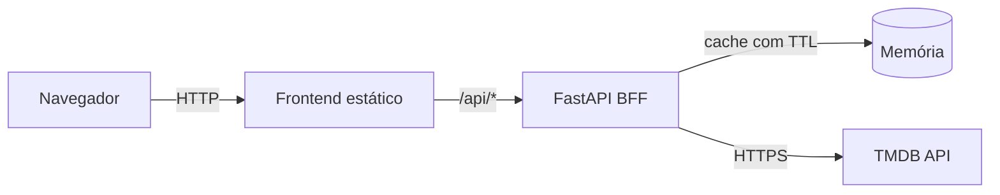

# Sala Escura

[](https://github.com/Henriquewalker31/Sala-Escura/actions/workflows/ci.yml)
[](https://www.python.org/)
[](https://fastapi.tiangolo.com/)
[](https://www.themoviedb.org/)

Catálogo de filmes full stack: **FastAPI** no backend, **JavaScript puro** no frontend e a **API do TMDB** como fonte de dados. Busca por título, destaques da semana, filtro por gênero e ficha técnica com sinopse, direção, elenco, duração e trailer — tudo com um visual inspirado em sala de cinema.

## Visão geral

O navegador nunca fala com o TMDB diretamente. Um pequeno BFF (Backend For Frontend) em FastAPI concentra a credencial, normaliza as respostas, aplica cache e entrega ao frontend apenas o que ele precisa. O resultado é um frontend sem build, sem `npm` e sem chave exposta.



## Funcionalidades

- Busca por título com debounce e tolerância a acentos e caixa.
- Filmes em alta na semana (ou no dia), com paginação.
- Filtro por gênero nos chips do topo.
- Ficha técnica em `<dialog>` nativo: sinopse, tagline, direção, elenco, duração, gêneros, nota e trailer.
- Cache em memória com TTL para reduzir chamadas ao TMDB.
- Modo demo automático: sem credencial, a aplicação sobe com um catálogo local.
- Arte tipográfica gerada quando o filme não tem pôster — nunca uma imagem quebrada.
- Interface acessível: navegação por teclado, `aria-live`, foco visível e `prefers-reduced-motion`.

## Stack

| Camada | Tecnologia |
|---|---|
| Backend | Python 3.10+, FastAPI, Uvicorn, HTTPX, python-dotenv |
| Frontend | HTML, CSS e JavaScript puro (ES Modules) |
| Dados | TMDB API v3/v4 |
| Testes | Pytest + FastAPI TestClient |
| CI | GitHub Actions |

## Como rodar

Pré-requisitos: **Python 3.10+** e, opcionalmente, uma credencial do TMDB.

### Linux / macOS

```bash
git clone https://github.com/Henriquewalker31/Sala-Escura.git
cd Sala-Escura
cp .env.example .env      # preencha uma das credenciais
./run.sh
```

### Windows (PowerShell)

```powershell
git clone https://github.com/Henriquewalker31/Sala-Escura.git
cd Sala-Escura
python -m venv .venv
.\.venv\Scripts\Activate.ps1
pip install -r backend\requirements.txt
uvicorn app.main:app --app-dir backend --reload --port 8000
```

Abra <http://localhost:8000>. A interface e a API são servidas pelo mesmo processo.

Sem credencial, a aplicação inicia em **modo demo** com o catálogo de `frontend/demo-data.json` — o selo no topo indica o modo ativo.

## Configuração

Copie `.env.example` para `.env` na raiz do projeto (um `.env` em `backend/` também é aceito e tem precedência).

| Variável | Obrigatória | Padrão | Descrição |
|---|---|---|---|
| `TMDB_API_KEY` | uma das duas | — | Chave da API v3 |
| `TMDB_ACCESS_TOKEN` | uma das duas | — | Token de leitura v4 (Bearer) |
| `TMDB_LANGUAGE` | não | `pt-BR` | Idioma das respostas |
| `CACHE_TTL` | não | `600` | Tempo de vida do cache, em segundos |

> A chave v3 vai em `TMDB_API_KEY`; o token v4 vai em `TMDB_ACCESS_TOKEN`. Não inverta os campos.

### Obtendo a credencial

1. Crie uma conta em <https://www.themoviedb.org/signup>.
2. Acesse **Configurações → API** e solicite uma chave de uso pessoal.
3. Copie a **Chave da API (v3)** para `TMDB_API_KEY` ou o **Token de Leitura (v4)** para `TMDB_ACCESS_TOKEN`.

## API

| Método | Rota | Descrição |
|---|---|---|
| `GET` | `/api/health` | Modo atual (`tmdb`/`demo`), idioma e itens em cache |
| `GET` | `/api/trending?window=week&page=1` | Filmes em alta (dia ou semana) |
| `GET` | `/api/search?q=bacurau&page=1` | Busca por título |
| `GET` | `/api/discover?genre_id=18&page=1` | Populares de um gênero |
| `GET` | `/api/movies/{id}` | Ficha completa com elenco e trailer |
| `GET` | `/api/genres` | Gêneros disponíveis |
| `GET` | `/docs` | Documentação interativa (Swagger UI) |

Exemplo de cartão retornado pelas listas:

```json
{
  "id": 598,
  "title": "Cidade de Deus",
  "year": 2002,
  "overview": "…",
  "poster": "https://image.tmdb.org/t/p/w500/…",
  "rating": 8.4,
  "votes": 7400,
  "media_type": "movie"
}
```

A ficha (`/api/movies/{id}`) acrescenta `tagline`, `runtime`, `genres`, `director`, `cast`, `trailer` e `homepage`.

## Estrutura do projeto

```
Sala-Escura/
├── run.sh                      # sobe tudo em :8000 (Linux/macOS)
├── .env.example
├── backend/
│   ├── app/
│   │   ├── main.py             # rotas FastAPI, CORS e arquivos estáticos
│   │   ├── tmdb.py             # cliente HTTP + normalização
│   │   ├── cache.py            # cache em memória com TTL
│   │   └── demo.py             # catálogo local para rodar sem chave
│   ├── tests/test_api.py       # testes de contrato (sem rede)
│   ├── pytest.ini
│   ├── requirements.txt
│   └── requirements-dev.txt
├── frontend/
│   ├── index.html
│   ├── styles.css
│   ├── app.js                  # busca, filtros e ficha em <dialog>
│   └── demo-data.json
└── .github/workflows/ci.yml    # testes a cada push/PR
```

## Testes

```bash
pip install -r backend/requirements.txt -r backend/requirements-dev.txt
cd backend
python -m pytest -q
```

Os testes limpam as variáveis de ambiente e forçam o modo demo, então rodam offline e sem gastar requisições: contrato dos cartões, busca sem acento, ficha com direção e gêneros, 404 e 422.

## Decisões de projeto

- **BFF em vez de chamada direta**: a credencial fica no servidor e o frontend consome um formato estável.
- **Normalização na borda**: `poster_path`, `vote_average` e `first_air_date` viram `poster`, `rating` e `year` — trocar a fonte de dados fica barato.
- **Cache sem lock**: entre a leitura e a escrita do dicionário não existe `await`, então não há corrida dentro de um único event loop.
- **`<dialog>` nativo**: foco preso, `Esc` para fechar e backdrop sem biblioteca.
- **Paleta de sala escura**: preto quase puro, azul de projeção e vermelho de cortina, com grão de filme sutil.
- **Zero build no frontend**: módulos ES direto no navegador; quando o projeto crescer, migrar para React/Vite não exige mudar a API.

## Roadmap

- [ ] Favoritos com login (SQLite + JWT).
- [ ] Persistência de fichas visitadas em Postgres.
- [ ] Deploy com Docker e segredo de ambiente.
- [ ] Suporte a séries e pessoas.

## Créditos

Este produto usa a API do TMDB, mas não é endossado nem certificado pelo TMDB.

Dados de `frontend/demo-data.json` são uma amostra aproximada, escrita para o projeto funcionar offline.

## Autor

Feito por [Henrique Walker](https://github.com/Henriquewalker31).
